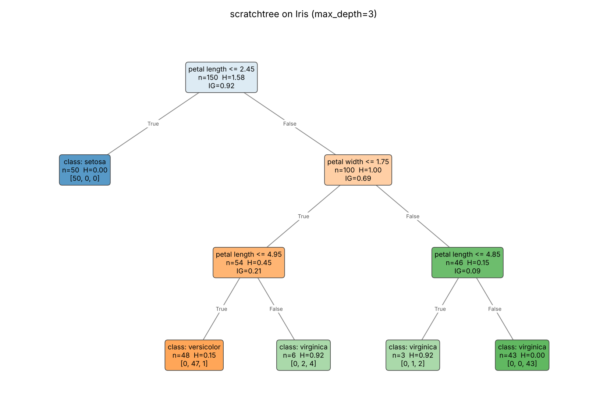
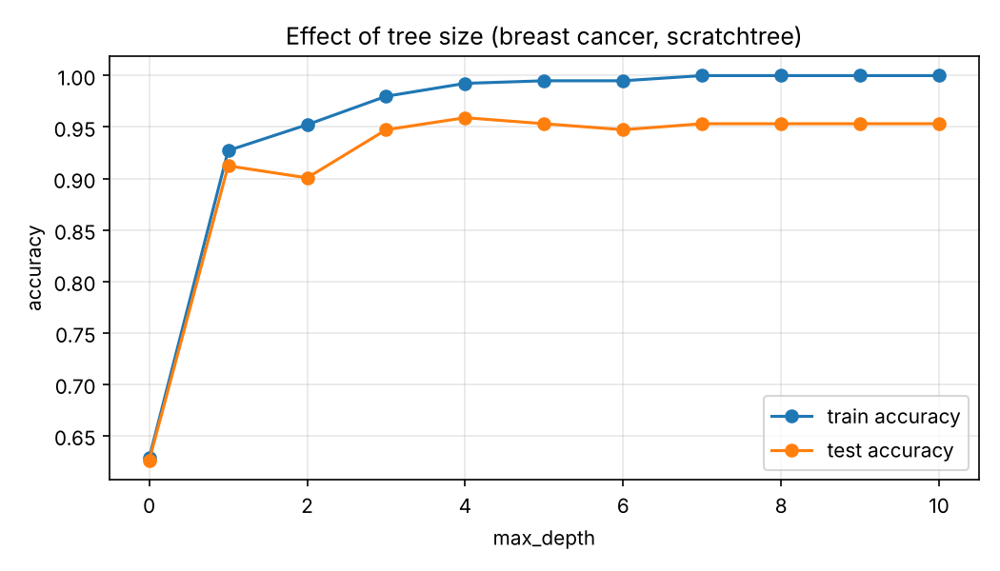

# Decision Tree from Scratch — Report

**Author:** Aravind
**GitHub repository:** https://github.com/aravindreddykolan14-debug/scratchtree-
**PyPI package:** https://pypi.org/project/scratchtree-aravind/  (`pip install scratchtree-aravind`)

## 1. Summary

I implemented a decision tree classifier from scratch in Python, using only NumPy for the algorithm itself. Splits are chosen by **information gain** computed from **entropy**. The tree size is controlled by five hyperparameters, the tree can be displayed in three ways (text, Graphviz, matplotlib), and the project is packaged for PyPI.

| Requirement | Status |
|---|---|
| Decision tree from scratch, entropy + information gain | Done — `src/scratchtree/criteria.py`, `src/scratchtree/tree.py` |
| Hyperparameter for the size of the tree | Done — `max_depth`, `min_samples_split`, `min_samples_leaf`, `max_leaf_nodes`, `min_information_gain` |
| Bonus: display the tree | Done — `export_text()`, `export_dot()`, `plot()` |
| Bonus: packaged and deployed on PyPI | Done — `pyproject.toml`, published as `scratchtree-aravind` |

scikit-learn is used **only** in the tests and the demo, to load datasets and to compare results.

## 2. Algorithm

### 2.1 Entropy and information gain

For a set of samples *S* with class proportions *p_k*:

$$H(S) = -\sum_k p_k \log_2 p_k$$

Entropy is 0 for a pure node and log₂(K) for K equally represented classes (1 bit for two classes).

A split sends *S* into a left child *L* and a right child *R*. Its information gain is the reduction in entropy:

$$IG(S, L, R) = H(S) - \left(\frac{|L|}{|S|} H(L) + \frac{|R|}{|S|} H(R)\right)$$

Both functions work on **class-count vectors** rather than label lists, which is what makes the fast split search below possible.

### 2.2 Choosing a split

Features are numeric, and each split is a binary test `x[j] <= t`. For each feature *j*:

1. Sort the node's samples by `x[j]`.
2. A cumulative sum of one-hot labels gives the class counts of the left child for every "first *i* samples go left" position at once; the right child's counts are total minus left.
3. Keep only positions where the feature value actually changes, and where both children respect `min_samples_leaf`.
4. Compute the gain of every candidate in one vectorised step and keep the best one. The threshold is the midpoint between the two neighbouring values.

This costs O(n log n) per feature per node instead of the O(n²) of a naive loop over thresholds. The best (feature, threshold) over all features is selected.

### 2.3 Growing the tree

The tree is grown **best-first**: candidate nodes wait in a priority queue ordered by *n_node × IG*, and the most useful split is made next. When the leaf count is unlimited this gives exactly the same tree as the classic recursive (depth-first) ID3 algorithm; when `max_leaf_nodes` is set, it means the leaf budget is spent on the splits that reduce entropy the most, not just the ones nearest the root.

A node becomes a leaf when it is pure, or when any size limit prevents a split. A leaf predicts its majority class; `predict_proba` returns the class proportions in the leaf.

**Zero-gain splits.** A first version refused splits with zero gain. The XOR test caught the problem: on XOR data no single split reduces entropy, so the tree stayed a single leaf even with `max_depth=2`, although two levels separate the data perfectly. Zero-gain splits are now accepted (unless `min_information_gain > 0`), which is also what scikit-learn does. This is a good illustration of the greedy nature of the algorithm: it only looks one split ahead.

### 2.4 Tree-size hyperparameters

| Parameter | Default | Effect |
|---|---|---|
| `max_depth` | `None` | Maximum depth (root = depth 0). |
| `min_samples_split` | `2` | A node needs at least this many samples to be split. |
| `min_samples_leaf` | `1` | Each child of a split must keep at least this many samples. |
| `max_leaf_nodes` | `None` | Maximum number of leaves (uses the best-first growth). |
| `min_information_gain` | `0.0` | A split must gain at least this many bits. |

All of them are pre-pruning rules: they stop growth early to avoid overfitting.

### 2.5 API

The class follows the scikit-learn conventions: `fit`, `predict`, `predict_proba`, `score`, `get_params`/`set_params`, plus `get_depth()`, `get_n_leaves()`, `node_count`, `classes_` and `feature_importances_` (total weighted information gain contributed by each feature, normalised to sum to 1). Labels can be of any type (ints, strings), and feature names are read from a pandas DataFrame automatically.

```python
from scratchtree import DecisionTreeClassifier

tree = DecisionTreeClassifier(max_depth=3, min_samples_leaf=2)
tree.fit(X_train, y_train, feature_names=names)
tree.score(X_test, y_test)
```

## 3. Displaying the tree (bonus)

- `tree.export_text()` — indented text view with threshold, sample count, entropy *H* and gain *IG* at each node.
- `tree.export_dot()` — Graphviz source (`dot -Tpng tree.dot -o tree.png`).
- `tree.plot()` — matplotlib drawing; leaf colour shows the predicted class and its intensity shows the purity (1 − normalised entropy).

Iris, `max_depth=3`:

```
|--- petal length <= 2.450  (n=150, H=1.585, IG=0.918)
|   |--- class: setosa  (n=50, H=0.000, [50, 0, 0])
|--- petal length >  2.450
|   |--- petal width <= 1.750  (n=100, H=1.000, IG=0.690)
|   |   |--- petal length <= 4.950  (n=54, H=0.445, IG=0.213)
|   |   |   |--- class: versicolor  (n=48, H=0.146, [0, 47, 1])
|   |   |--- petal length >  4.950
|   |   |   |--- class: virginica  (n=6, H=0.918, [0, 2, 4])
|   |--- petal width >  1.750
|   |   |--- petal length <= 4.850  (n=46, H=0.151, IG=0.091)
|   |   |   |--- class: virginica  (n=3, H=0.918, [0, 1, 2])
|   |   |--- petal length >  4.850
|   |   |   |--- class: virginica  (n=43, H=0.000, [0, 0, 43])
```



The root split is a textbook result: `petal length <= 2.45` isolates all 50 setosa samples, taking entropy from log₂3 ≈ 1.585 bits to 0.667 bits (IG = 0.918).

## 4. Results

### 4.1 Comparison with scikit-learn

Test accuracy on a stratified 30% hold-out (`random_state=0`), against `sklearn.tree.DecisionTreeClassifier(criterion="entropy", random_state=0)`:

| Dataset | max_depth | scratchtree | scikit-learn |
|---|---|---|---|
| Iris | 2 | 0.956 | 0.956 |
| Iris | 4 | 0.889 | 0.889 |
| Iris | None | 0.889 | 0.956 |
| Wine | 2 | 0.963 | 0.963 |
| Wine | 4 | 0.926 | 0.944 |
| Wine | None | 0.926 | 0.944 |
| Breast cancer | 2 | 0.883 | 0.883 |
| Breast cancer | 4 | 0.930 | 0.930 |
| Breast cancer | None | 0.924 | 0.930 |

For shallow trees the results are identical, and the root split on the breast cancer dataset (feature and threshold) matches scikit-learn exactly. The small differences for deeper trees come from **ties**: when two splits have exactly the same gain, scikit-learn chooses between them at random (it shuffles features), while my implementation keeps the first feature. This is confirmed by refitting scikit-learn's full Iris tree with `random_state` 0 to 7: its test accuracy varies between 0.889 and 0.956 — always with 10 leaves and depth 7, the same size as mine — and my 0.889 falls inside that range. The two implementations agree on the method; only the tie-breaking differs.

### 4.2 Effect of the tree size

Breast cancer dataset (569 samples, 30 features), 30% test split:

| max_depth | leaves | train acc. | test acc. |
|---|---|---|---|
| 0 | 1 | 0.628 | 0.626 |
| 1 | 2 | 0.927 | 0.912 |
| 2 | 4 | 0.952 | 0.901 |
| 3 | 7 | 0.980 | 0.947 |
| **4** | **11** | **0.992** | **0.959** |
| 5 | 13 | 0.995 | 0.953 |
| 7 | 15 | 1.000 | 0.953 |
| 10 | 15 | 1.000 | 0.953 |



Training accuracy keeps rising until the tree memorises the training set (100% at depth 7), while test accuracy peaks at depth 4 (95.9%) and then falls slightly: past that point the tree fits noise. Depth 0 is the majority-class baseline (62.6%). A single split already reaches 91.2%, which shows how informative one good feature can be.

With `max_leaf_nodes`, 8 leaves already reach the best test accuracy of the unlimited tree (0.953), because best-first growth places the splits where they matter most.

### 4.3 Tests

The test suite (`tests/test_tree.py`, 41 checks including doctests, all passing) covers:

- entropy and information gain on hand-computed values (e.g. H([9, 5]) = 0.940, the "play tennis" example);
- XOR (needs a zero-gain first split), perfect fit when unlimited, single-class data, string labels, probabilities summing to 1;
- every size hyperparameter is respected (depth, leaf count, samples per leaf/split, minimum gain);
- comparison with scikit-learn on three datasets and four depths, and identical root split;
- the three display functions.

## 5. Packaging (bonus)

The project uses a standard `src/` layout with `pyproject.toml`. NumPy is the only required dependency; matplotlib is an optional extra (`pip install "scratchtree-aravind[plot]"`).

```
scratchtree/
├── pyproject.toml
├── README.md
├── LICENSE
├── report.md
├── src/scratchtree/
│   ├── __init__.py
│   ├── criteria.py     # entropy, information gain
│   ├── tree.py         # DecisionTreeClassifier
│   └── display.py      # export_text, export_dot, plot_tree
├── tests/test_tree.py
├── examples/demo.py    # comparison + hyperparameter sweeps + figures
└── images/
```

Build and publish:

```bash
pip install build twine
python -m build                 # creates dist/*.tar.gz and dist/*.whl
twine check dist/*
twine upload dist/*             # uses a PyPI API token
```

## 6. Limitations and possible improvements

- Only numeric features; categorical features need to be encoded first (one-hot or ordinal).
- No missing-value handling.
- Pre-pruning only; post-pruning (e.g. cost-complexity pruning) could be added.
- Classification only; a regression tree would replace entropy with variance.
- Prediction walks the tree in Python, one sample at a time — fine for these datasets, but slower than a compiled implementation on large data.

## 7. How to reproduce

```bash
git clone https://github.com/aravindreddykolan14-debug/scratchtree-
cd scratchtree-
pip install -e ".[dev]"
pytest
python examples/demo.py
```
